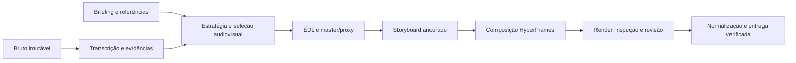

# Arquitetura

O agente decide sentido, performance, direção e adequação. Node/FFmpeg/HyperFrames executam operações determinísticas e validam contratos. A transcrição é evidência auxiliar, não um roteiro que autoriza inventar medidas ou remover um gesto silencioso.

| Camada | Responsabilidade |
| --- | --- |
| `scripts/vid.mjs`, `scripts/commands/` | CLI editorial e coordenação das etapas |
| `scripts/lib/` | Relógios, EDL, âncoras, assinaturas, cache, revisão e referências |
| `scripts/analysis/` | Worker Python opcional e lock de modelos; inferências locais sem decisões de corte |
| `templates/` | Projetos/composição genéricos, fontes licenciadas e primitivas de movimento |
| `.claude/skills/`, `.agents/skills/` | Instruções canônicas e seus links para agentes |
| `vendor/` | Origem, versão e licença das skills externas |
| `library/SOURCES.md`, `library/sources.json` | Catálogo público de consulta; não contém exemplos privados |
| `tests/` | Dados sintéticos, invariantes e integração de mídia |

Projetos ficam em `videos/<slug>/`, separados do mecanismo. `brand/`, referências aprendidas, `.cache/` e `output/` são privados. A distribuição usa duas barreiras: `.gitignore` e a política testada de `scripts/lib/public-repo.mjs`.

O relógio começa no primeiro quadro de vídeo, com offset original do áudio preservado. Palavras do bruto e do corte têm relógios distintos; `source_i` e `segment_id` preservam a origem após reordenar takes. A edição não faz crop destrutivo do master antes da composição.

As assinaturas invalidam decisões dependentes quando o conteúdo muda. O cache evita recomputar bytes independentes dessa mudança, sem restaurar aprovação. Consulte [EFFICIENCY.md](EFFICIENCY.md) e [PIPELINE.md](PIPELINE.md) para os contratos específicos.

Os [sinais auxiliares](SIGNALS.md) ficam fora das assinaturas de aprovação. A CLI verifica origem/hashes, mede áudio alinhado ou janelas do proxy SDR e grava relatórios separados. O worker recebe mídia local e retorna amostras; não escreve EDL, palavras ou estado. Apenas `signals setup` instala dependências/modelos em `.cache/vid-tools/`.
